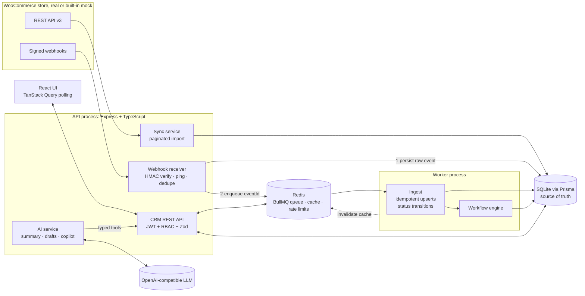
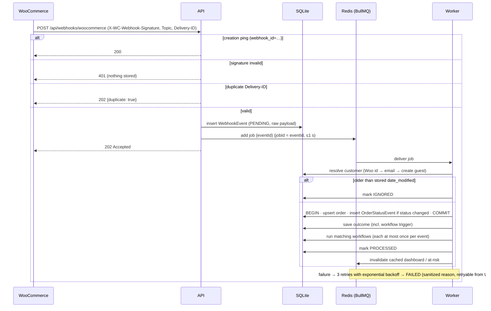
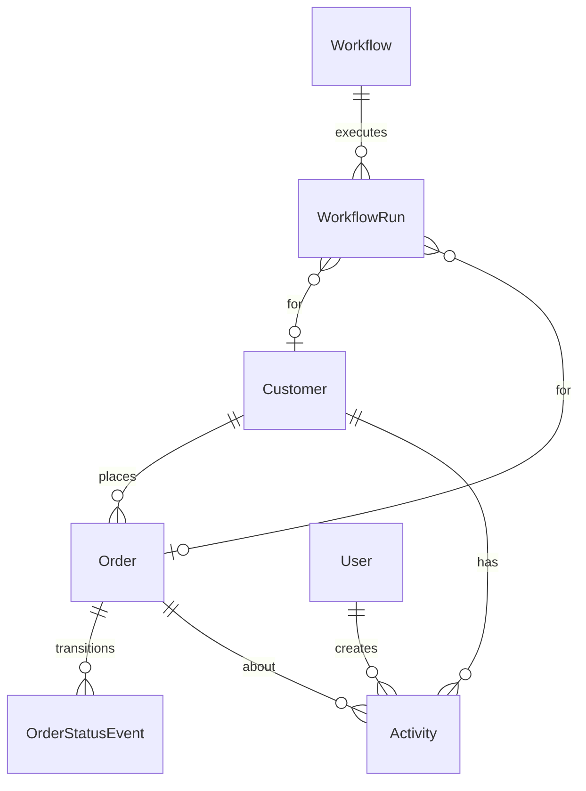

# WooPulse CRM

**A WooCommerce-connected CRM with real-time sync, automated customer communication, Redis-backed background processing and a human-in-the-loop AI assistant.**

WooPulse connects to a WooCommerce store, keeps a live copy of its customers and orders, flags orders that need attention, runs follow-up automations when order statuses change, and gives support agents an AI assistant that summarises customers and drafts emails, but never sends anything without a person's approval.

| | |
|---|---|
| **Stack** | TypeScript · Node.js 24 · Express 5 · Prisma · SQLite · Redis 7 · BullMQ · React 19 · Vite · Tailwind CSS 4 · TanStack Query · Zod · Vitest |
| **Integration** | WooCommerce REST API v3 (initial import) + HMAC-signed webhooks (real time) |
| **Background processing** | BullMQ queue on Redis, consumed by a separate worker process (in-process fallback without Redis) |
| **AI** | Any OpenAI-compatible API (default: Groq `openai/gpt-oss-120b`) with typed, validated tools |
| **Quality** | 48 automated tests · two traced QA audit runs with evidence (`CRM_AUDIT_PLAN.md`, `CRM_ISSUES.md`) |

---

## Contents
1. [The problem](#the-problem)
2. [Features](#features)
3. [Quick start](#quick-start)
4. [Architecture](#architecture)
5. [How it works](#how-it-works)
6. [Redis: what it does here](#redis-what-it-does-here)
7. [Data model](#data-model)
8. [Security](#security)
9. [AI assistant](#ai-assistant)
10. [Workflows](#workflows)
11. [API reference](#api-reference)
12. [Testing and quality assurance](#testing-and-quality-assurance)
13. [Project structure](#project-structure)
14. [Design decisions and trade-offs](#design-decisions-and-trade-offs)
15. [Known limitations and roadmap](#known-limitations-and-roadmap)
16. [Further documentation](#further-documentation)

---

## The problem

WooCommerce shows a store owner **orders**, but not **customer relationships**. Lifetime value, history across orders, which orders are at risk, and what to do next are scattered across WP Admin, an inbox and people's memory. Follow-ups such as "apologise when an order is put on hold" or "ask for a review when it completes" are manual and easy to forget.

**WooPulse** turns WooCommerce's events into customer operations: a live customer 360, automatic follow-ups, risk detection, and an AI assistant that drafts but never acts alone.

---

## Features

| Area | What it does |
|---|---|
| **WooCommerce sync** | Paginated import of customers and orders over REST v3 with retry and exponential backoff on HTTP 429/5xx. Real-time updates from signed webhooks (`order.created`, `order.updated`, `customer.created`, `customer.updated`). Basic auth over HTTPS and **OAuth 1.0a request signing over plain HTTP**, as WooCommerce requires. |
| **Guest checkout** | Guest orders arrive with `customer_id = 0`. They are matched to a CRM customer by **normalised billing email**, and merged when the guest later registers. |
| **Customer 360** | Contact card, lifetime value, order count, average order value, tags, risk flags, order history, and one merged **timeline** of orders, status changes, notes, tasks, emails and AI insights. |
| **Order tracking** | Filter by status, amount, date range, customer or order number. Order detail shows line items, payment method, a **status history** built from webhook transitions, the automation runs for that order, and risk explanations. The UI refreshes automatically as webhooks arrive. |
| **At-risk detection** | Deterministic, unit-tested rules: high-value order on hold, on hold > 24 h, processing > 72 h, failed or pending payment, loyal customer cancelled, refund pattern. Each flag has a severity, a reason and a suggested action. |
| **Workflows** | Trigger → conditions → actions engine with `{{template}}` variables and five seeded automations. Every run is logged with per-action results. Each workflow is isolated: a broken one fails alone and is never run twice for the same event. |
| **AI assistant** | Grounded customer summaries that cite their source orders, personalised follow-up drafts (choice of tone and order), and a tool-using copilot. **No send tool**: emails are drafts until a person approves them. |
| **Notes, tasks and emails** | Manual notes and tasks with due dates, emails edited and approved from the timeline, and tasks marked done. |
| **Redis** | BullMQ job queue + separate worker, shared cache with cross-process invalidation, and login rate limiting. |
| **Sync health** | Store connection and sync status, full resync, webhook event log (processed / ignored / failed) with sanitized errors, queue driver and depth, cache hit rate, and retry of failed events. |
| **Team access** | JWT login with brute-force lockout. `ADMIN` can resync, retry events and toggle workflows; `AGENT` handles day-to-day customer work. |
| **Mock WooCommerce store** | A built-in WooCommerce-compatible store at `/mock-woo` (REST endpoints, OAuth checks, signed webhooks, admin page) so the demo and tests never depend on an external store. |

---

## Quick start

**Requirements:** Node.js 20.12+ (developed on 24) and npm. Redis is optional.

```bash
git clone https://github.com/prathamnaik24/kilowott-hackathon.git
cd kilowott-hackathon
npm install
cp .env.example server/.env      # configuration template; see "Configuration" below
npm run dev                      # API :4000 · worker · UI http://localhost:5173
```

Open **http://localhost:5173** and sign in with the demo account **`admin@woopulse.dev` / `demo1234`** (or `agent@woopulse.dev` for the agent role).

On first start WooPulse creates its SQLite database, seeds the demo users and workflows, and **imports customers and orders from the built-in mock WooCommerce store**. No external services are required.

### See real-time sync in 30 seconds
1. Open the mock store admin at **http://localhost:4000/mock-woo/**.
2. Change a `processing` order to **on-hold**. The store sends a signed `order.updated` webhook.
3. Within a few seconds the CRM shows the status transition, the *on-hold apology* workflow run (email + task) on the **Workflows** page, and both entries on the customer's timeline.

Or from the command line: `npm run simulate -w server -- <wooOrderId> <status>` sends a correctly signed webhook.

### Run with Redis (BullMQ worker, shared cache, rate limiting)
Start Redis in one of these ways:
```bash
# Docker
docker compose up -d redis
# or natively, e.g. in WSL/Ubuntu
sudo apt install -y redis-server && sudo service redis-server start
```
Then set `REDIS_URL=redis://localhost:6379` in the configuration and restart `npm run dev`. The **Sync health** page then shows **Queue: BullMQ (Redis)** and **Cache: Redis**.

### Configuration
All settings are documented in [`.env.example`](.env.example). The main groups are:

| Group | Purpose |
|---|---|
| Server | port, public URL, database location, JWT signing secret |
| WooCommerce | store URL, consumer key/secret, webhook secret, mock-store switch |
| Redis | `REDIS_URL` (empty = in-process queue and in-memory cache), optional worker-in-API mode |
| AI | any OpenAI-compatible base URL, API key and model (default Groq `openai/gpt-oss-120b`) |
| Demo | seeded admin email and password |

Without an AI key, summaries and drafts fall back to rule-based output so the app still works; the copilot needs an LLM.

### Connect a real WooCommerce store
1. In WP Admin, open **WooCommerce → Settings → Advanced → REST API** and create a key with **Read/Write** permission.
2. Set the store URL and consumer key/secret in the configuration and disable the mock store.
3. In **WooCommerce → Settings → Advanced → Webhooks**, add `Order created`, `Order updated`, `Customer created` and `Customer updated` with delivery URL `https://<your-host>/api/webhooks/woocommerce` and the same secret as the webhook secret in the configuration.
4. Restart and click **Full resync** on *Sync health*.

The real store and the mock store go through **exactly the same client, signature verification and ingestion code**.

### Local WooCommerce test store (Docker)
`docker-compose.woocommerce.yml` provisions MySQL 8, WordPress (PHP 8.2/Apache) on port 8080 and a one-shot **WP-CLI setup** that installs WooCommerce, enables pretty permalinks, seeds products, customers and orders (including guest orders), creates a REST key and registers signed webhooks. A small must-use plugin, for the local test store only, allows WordPress to deliver webhooks to `host.docker.internal:4000` / `api:4000` (WordPress normally blocks private hosts and non-standard ports) and delivers them synchronously.
```bash
docker compose -f docker-compose.woocommerce.yml up -d
```
> Status: written and reviewed, but not yet executed end to end. The development machine's Docker engine was unavailable; see `CRM_ISSUES.md` (ENV-01/ENV-05).

### Scripts
| Command | What it does |
|---|---|
| `npm run dev` | API, BullMQ worker and UI in watch mode |
| `npm test` | 48 unit and integration tests |
| `npm run typecheck` | TypeScript checks for server and client |
| `npm run build` / `npm start` | Production build; single server on :4000 serving API + UI |
| `npm run worker` | Run the BullMQ worker on its own |
| `npm run simulate -w server -- <id> <status>` | Send a signed WooCommerce webhook |

---

## Architecture



| Process | Entry point | Role |
|---|---|---|
| API | `server/src/server.ts` | HTTP API, webhook intake, serves the built UI in production |
| Worker | `server/src/worker.ts` | Consumes the BullMQ queue (the API consumes it in-process when Redis isn't configured) |
| Frontend | `client/` | React single-page app; talks **only** to the API |
| Redis | external | Queue, cache, rate-limit counters |

---

## How it works

### Webhook processing ("persist first, then queue")


**Idempotency at four levels:**
- A duplicate `X-WC-Webhook-Delivery-ID` is acknowledged without being reprocessed.
- The BullMQ `jobId` equals the event ID, so the same event can't be queued twice.
- Unique WooCommerce order/customer IDs mean replays update rather than duplicate.
- A workflow run is unique per (workflow, event), so retries never repeat side effects.

**Ordering and staleness:** status events are only written when the status actually changes, and payloads older than the stored `date_modified` are ignored. The worker runs with concurrency 1 so transitions apply in arrival order.

### Data flow summary
| From → To | Mechanism |
|---|---|
| WooCommerce → WooPulse (history) | REST v3, 50 per page, `X-WP-TotalPages` pagination, retry on 429/5xx |
| WooCommerce → WooPulse (live) | Signed webhooks pushed by WooCommerce; the store is never polled |
| WooPulse → browser | JSON API with JWT; TanStack Query caches and polls (3–5 s) so webhook changes appear without a refresh |
| WooPulse → LLM | A JSON snapshot of one customer's real data, or typed tool calls from the copilot |

### Metrics
WooCommerce REST v3 doesn't return `total_spent`/`orders_count` for customers, and guest orders never appear in `/customers`. **Lifetime value is therefore computed from synced orders**: `processing`, `on-hold` and `completed` count; `pending`, `cancelled`, `refunded` and `failed` don't. The dashboard revenue equals the sum of all customers' lifetime values (verified in the audit).

---

## Redis: what it does here

Redis has **three distinct jobs**, all verified live against Redis 7:

1. **Message queue (BullMQ).** The API only verifies, saves and enqueues; a **separate worker process** does the heavy work. Jobs survive API restarts, retry 3 times with exponential backoff, and are deduplicated by job ID. Keys: `bull:woopulse-webhooks:*`.
2. **Shared cache (cache-aside).** The dashboard and the store-wide at-risk scan are cached for 30 s. Because the worker is a different process, **it invalidates the cache through Redis** after every processed webhook, so numbers are never stale for long. Hit/miss counters are shown on *Sync health*. Cache errors fail open (the value is recomputed). Keys: `woopulse:cache:*`.
3. **Login rate limiting.** `INCR` + `EXPIRE` in one atomic `MULTI`: 5 failed attempts per IP + email lock the login for 15 minutes, with a `Retry-After` header. A correct password doesn't bypass an active lockout. The counter is shared by every API instance. Keys: `woopulse:ratelimit:*`.

**Resilience:** the database stays the source of truth. Every webhook is stored before it reaches Redis. If Redis is unreachable, every queue call is bounded to 1 s: the webhook is still acknowledged and kept `PENDING`, and a sweeper re-queues it every 30 s once Redis is back. This is covered by a regression test that points the app at a closed Redis port. Without `REDIS_URL`, the same code uses an in-process queue and an in-memory cache.

**Why not Kafka?** Kafka is built for high-volume event streams with many independent consumers and long-term replay. WooPulse has one consumer type and a store's order volume, which is a *job queue* problem, and that's BullMQ's purpose.

---

## Data model



| Model | Purpose | Integrity |
|---|---|---|
| `User` | CRM login, role `ADMIN`/`AGENT`, **bcrypt hash** | unique email |
| `Store` | Sync status, last sync, last error | single store |
| `Customer` | Contact data, guest flag, tags | unique `wooCustomerId` (null for guests), unique email |
| `Order` | Status, total, currency, payment method, line items | unique `wooOrderId`; `wooModifiedAt` guards against stale events |
| `OrderStatusEvent` | previous → new status, source (`SYNC`/`WEBHOOK`/`CRM`), time | written in the same transaction as the order |
| `Activity` | Notes, tasks, emails (`DRAFT`/`SENT`), AI summaries; origin `user`/`ai`/`workflow:<key>` | linked to customer and optional order |
| `Workflow` | Trigger, conditions, actions, active flag | unique key |
| `WorkflowRun` | Every execution with per-action results | unique (workflow, webhook event) |
| `WebhookEvent` | Raw delivery, status, attempts, saved outcome, sanitized error | unique delivery ID |

Schema: [`server/prisma/schema.prisma`](server/prisma/schema.prisma).

---

## Security

| Concern | Implementation |
|---|---|
| Passwords | **bcrypt** (cost 10, salted). Hashes are never returned by the API. |
| Sessions | **JWT signed with HMAC-SHA256**, 12 h expiry. Tampered role claims are rejected. |
| Webhook authenticity | **HMAC-SHA256 over the raw request body**, compared with `crypto.timingSafeEqual`. Forged requests get 401 and change nothing. |
| Requests to WooCommerce | Basic auth over HTTPS; **OAuth 1.0a (HMAC-SHA256, nonce, timestamp)** over HTTP |
| Brute force | Redis-backed login lockout (5 failures / 15 min per IP + email) |
| Authorization | Role checks on every admin endpoint, mirrored by disabled controls in the UI |
| Input validation | Zod schemas on every body, query and AI tool argument |
| Secrets | Server-side only. The browser talks only to the WooPulse API, never to WooCommerce, Redis or the LLM. No endpoint returns credentials (audited). |
| Error hygiene | Stored processing errors are sanitized (no file paths or database internals) |
| AI safety | No send-email tool, no SQL, tool arguments validated, drafts need human approval |

Not yet implemented: encryption of data at rest (database file and store credentials), TLS termination (provided by the hosting platform or a reverse proxy), restricted CORS, and refusal of default secrets in production. These are tracked in `CRM_ISSUES.md`.

---

## AI assistant

- **Rules decide, AI explains.** Risk flags come from deterministic, unit-tested rules; the LLM summarises them and suggests a next action.
- **Grounded summaries.** The model receives only a JSON snapshot of the customer's real data, must not invent facts or promise refunds/discounts, and returns the order numbers it relied on. Verified live: a summary cited exactly the customer's two real orders and the correct lifetime value.
- **Follow-up drafter.** Goal, tone and an optional order produce an editable email saved as a `DRAFT` on the timeline.
- **Copilot agent.** Plans and calls typed CRM tools in a loop (max 6 steps): `search_customers`, `get_customer_profile`, `get_customer_timeline`, `list_orders`, `get_at_risk_orders`, `create_task`, `draft_email`. Every argument is Zod-validated, and the UI shows the full tool trace.
- **Human in the loop.** There is no tool that sends email. Sending happens only through the *Approve & send* button.
- **Provider-agnostic.** It calls the OpenAI-compatible HTTP API directly (no vendor SDK), so Groq, OpenAI, OpenRouter or a local Ollama model is a configuration change.
- **Graceful degradation.** Without a key, summaries and drafts use rule-based output.

---

## Workflows

| Workflow | Trigger | Condition | Actions |
|---|---|---|---|
| On-hold apology | Order status changed | new status = `on-hold` | Send apology email · create support task (due 24 h) |
| Review request | Order status changed | new status = `completed` | Send review-request email |
| VIP follow-up | Order created | total ≥ 200 | Create personal thank-you task (due 4 h) · tag `vip` |
| Cancellation retention | Order status changed | new status = `cancelled` | Create retention task · tag `churn-risk` |
| Welcome | Customer created | — | Send welcome email |

- Conditions support `eq`, `neq`, `gt`, `gte`, `lt`, `lte`, `in` and `contains` over the order and customer context. Templates use `{{customer.firstName}}`, `{{order.number}}` and similar.
- **The initial import never triggers workflows** (verified), so connecting a store doesn't email existing customers.
- Admins can toggle each workflow; the **execution log** shows every run and per-action result.
- Email delivery currently uses a logging transport that records each message on the customer timeline.

---

## API reference

All endpoints except health, login and webhooks require `Authorization: Bearer <JWT>`. 🔒 = `ADMIN` only.

| Method | Path | Description |
|---|---|---|
| GET | `/api/health` | Liveness |
| POST | `/api/auth/login` | Log in → JWT (rate-limited) |
| GET | `/api/auth/me` | Current user |
| POST | `/api/webhooks/woocommerce` | WooCommerce webhook receiver (HMAC-verified) |
| GET | `/api/dashboard` | KPIs, orders by status, at-risk, recent orders and runs (cached) |
| GET | `/api/customers` | List and search (`search`, `tag`, `minSpent`, `minOrders`, `sort`) |
| GET | `/api/customers/:id` | Customer 360 with metrics and orders |
| GET | `/api/customers/:id/timeline` | Merged timeline |
| GET | `/api/customers/:id/risks` | Risk flags for the customer's orders |
| PATCH | `/api/customers/:id` | Update tags |
| GET | `/api/orders` | List (`status`, `customerId`, `search`, `minTotal`, `maxTotal`, `from`, `to`, `limit`) |
| GET | `/api/orders/at-risk` | All flagged orders, most severe first |
| GET | `/api/orders/:id` | Order detail with status history, activities, workflow runs and risk |
| GET | `/api/orders/:id/status-history` | Status transitions |
| POST | `/api/activities` | Create note, task or email (draft or send) |
| GET | `/api/activities/tasks` | Open tasks across customers |
| PATCH | `/api/activities/:id` | Update status/title/body (e.g. mark a task done) |
| POST | `/api/activities/:id/send` | Approve and send an email draft (optionally edited) |
| GET | `/api/workflows` | Workflows with run counts |
| PATCH | `/api/workflows/:id` 🔒 | Enable/disable |
| GET | `/api/workflows/runs` | Execution log |
| GET | `/api/store` | Sync health: store, queue, cache, webhook events |
| POST | `/api/store/sync` 🔒 | Full resync |
| POST | `/api/store/webhooks/retry` 🔒 | Retry failed webhook events |
| GET | `/api/ai/status` | LLM availability and tool list |
| POST | `/api/ai/customers/:id/summary` | Grounded customer summary |
| POST | `/api/ai/customers/:id/draft` | Draft a follow-up email |
| POST | `/api/ai/copilot` | Tool-using agent |

---

## Testing and quality assurance

```bash
npm test
```

**48 tests (Vitest + Supertest)**, run without any external service:

- **Unit:**
  - WooCommerce payload mapper (guest orders, GMT dates, money parsing)
  - webhook HMAC verification (tampering, wrong secret, missing signature)
  - workflow condition evaluator and template renderer
  - risk rules and lifetime-value maths
  - retrying job queue (including recovery when its failure handler throws)
  - cache-aside and rate limiter
  - `.env` loading order
- **Integration** (Supertest against the real Express app and a throwaway SQLite database):
  - the full signed-webhook pipeline: creation ping, forged-signature rejection, guest customer creation, duplicate-delivery idempotency, status transitions triggering the right workflows, stale events
  - a broken workflow not blocking others, and retries not repeating side effects
  - login lockout, auth and role permissions
  - webhook intake with Redis unreachable (acknowledged in under 1 s and kept `PENDING`)

### Continuous QA audit
The project is audited against its own specification with a **requirement-to-test traceability matrix**:
- [`CRM_AUDIT_PLAN.md`](CRM_AUDIT_PLAN.md) traces 124 requirements to executed tests and probes, with evidence.
- [`CRM_ISSUES.md`](CRM_ISSUES.md) lists every defect with severity, reproduction steps, root cause, fix and regression test, plus the verdict and remediation plan of each run.
- [`audit/`](audit/) holds the probe scripts and sanitized raw evidence for each run.

The audit found real defects (for example lost workflow triggers on retry, a queue stall, and webhooks hanging when Redis was down). Each fix came with a regression test before being marked resolved. Open findings are listed honestly rather than hidden.

---

## Project structure

```
server/
  prisma/schema.prisma            data model
  src/
    server.ts · worker.ts         API and BullMQ worker entry points
    app.ts                        Express app, routing, error handling
    config/env.ts                 Zod-validated configuration
    integrations/woocommerce/     REST client, OAuth 1.0a signing, payload mapper, webhook HMAC
    queues/webhook-queue.ts       BullMQ driver + in-process driver behind one interface
    modules/
      sync/                       full import + idempotent ingest (upserts, transitions)
      webhooks/                   receiver, processing, retry and sweeper
      workflows/                  engine, condition evaluator, seeded workflows
      risk/                       deterministic at-risk rules
      ai/                         LLM client, typed CRM tools, summary/draft/copilot
      customers/ orders/ activities/ dashboard/ store/ auth/
    mock-woo/                     WooCommerce-compatible mock store + admin page
    lib/                          Redis, cache, rate limiter, job queue, templates, errors
  tests/unit · tests/integration
  scripts/simulate-webhook.ts
client/src/
  pages/                          Dashboard, Customers, Customer360, Orders, OrderDetail,
                                  Workflows, Copilot, Settings (Sync health), Login
  components/                     Layout (sidebar, search, live indicator), Timeline, UI kit
docker/woocommerce/               WP-CLI provisioning script + local-only webhook plugin
docs/                             architecture, video talking points
audit/                            QA probes and evidence
Dockerfile · docker-compose.yml · docker-compose.woocommerce.yml
```

---

## Design decisions and trade-offs

| Decision | Why | Trade-off / path forward |
|---|---|---|
| **SQLite via Prisma** | Zero infrastructure: anyone can run the full CRM with `npm install && npm run dev`. It enforces the unique constraints, foreign keys and transactions the integrity rules need. | Single writer, single machine. The schema is portable (string enums, JSON as text); moving to PostgreSQL is a provider change plus migrations, needed for concurrent writers and managed backups. |
| **Webhooks + REST, no polling** | Webhooks are WooCommerce's official real-time channel and share the REST payload shape, so one mapper serves both. | Webhooks can arrive out of order or twice, which is handled by the staleness guard and idempotency. |
| **Persist first, then queue** | The database is the source of truth; Redis can lose recent writes. | Slightly more writes per event, in exchange for no lost webhooks. |
| **BullMQ, not Kafka** | Job queue semantics (retries, backoff, dedup, failed-job set) fit the problem exactly. | Concurrency 1 for ordering; scale by sharding per store. |
| **In-process fallback** | Tests and quick starts need no Redis; one interface, two drivers. | Single-instance only without Redis. |
| **Rules decide, AI explains** | Deterministic, testable risk detection; the LLM adds language, not decisions. | Rule thresholds are fixed constants today. |
| **No send tool for the AI** | Human-in-the-loop safety for customer communication. | One extra click per AI email. |
| **Polling instead of WebSockets** | Simple, robust "live" UI; TanStack Query handles caching. | Up to ~3 s latency on screen. |
| **Built-in mock store** | Demos and tests never depend on an external store, and they use the same code paths as a real one. | Must be disabled for real deployments. |

---

## Known limitations and roadmap

Tracked with evidence in [`CRM_ISSUES.md`](CRM_ISSUES.md). The main open items:

- **Data edge cases:** a second guest order with **no billing email** is not ingested; a registered customer changing to an email already held by a guest record fails; concurrent first-time upserts can conflict.
- **AI:** the copilot can abort when the model emits `null` for an optional tool argument; LLM-cited sources are not yet validated against the database.
- **Integration resilience:** no request timeout on WooCommerce calls; network-level errors aren't retried; a single bad record fails the whole sync (no `PARTIAL` status).
- **Production hardening:** the mock store and default secrets are enabled unless overridden; CORS is open; credentials aren't encrypted at rest; errors from the LLM provider surface as generic 500s.
- **Not yet built:** PostgreSQL + versioned migrations and seed command, SMTP/Mailpit delivery, delayed/scheduled workflows, separate queues per job type, Playwright end-to-end tests.
- **Not yet executed:** the Docker image build and the Docker-based local WooCommerce store (the development machine's Docker engine was unavailable).

WooPulse is a working, tested prototype; it is **not** presented as production-ready.

---

## Further documentation

| Document | Contents |
|---|---|
| [`conclusions.md`](conclusions.md) | How everything works end to end: data sources, storage, security, Redis, flows, and a 3-minute demo script |
| [`docs/architecture.md`](docs/architecture.md) | Processes, components, Redis usage, retry safety, webhook sequence, ER diagram, AI agent design, deployment topology |
| [`docs/video-talking-points.md`](docs/video-talking-points.md) | Rationale behind every technology choice |
| [`CRM_AUDIT_PLAN.md`](CRM_AUDIT_PLAN.md) | Requirement-to-test traceability matrix |
| [`CRM_ISSUES.md`](CRM_ISSUES.md) | Defects, fixes, verification history and remediation plan |
