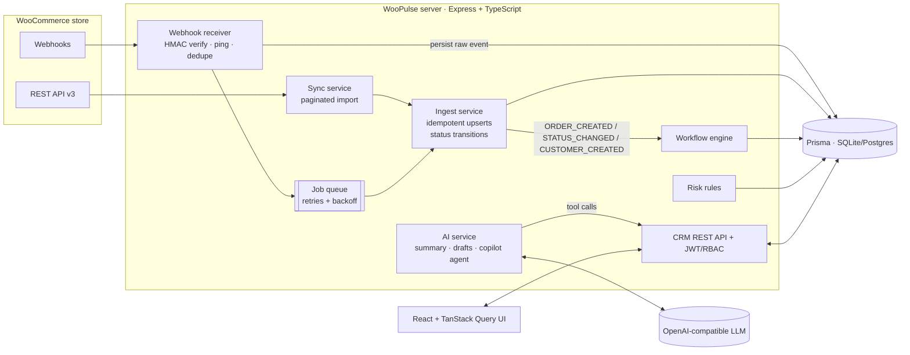

# WooPulse CRM

**A WooCommerce-connected CRM: real-time customer and order sync, automated communication workflows, and an agentic AI copilot that drafts follow-ups and flags at-risk orders.**

Store owners on WooCommerce have orders in one place, customer emails in another, and follow-ups in someone's head. WooPulse syncs WooCommerce customers and orders into a CRM and gives support agents a customer 360 view and live order tracking. Workflows react to store events automatically, and an AI agent works on the CRM data, with a human approving anything that goes out.

---

## Features

| Area | What it does |
|---|---|
| **WooCommerce integration** | Initial import over the REST API v3 (paginated, with retry/backoff), then real-time updates from **HMAC-signed webhooks** (`order.*`, `customer.*`). Handles **guest checkouts** (`customer_id = 0`) by matching on billing email. |
| **Customer 360** | Contact card, lifetime value, order count, average order value, tags, risk flags, order history, and one **timeline** that merges orders, status changes, notes, tasks, emails and AI insights. |
| **Order tracking** | Filter by status, date range, amount, customer or order number. Order detail shows line items, payment method, a **status history** built from webhook transitions, the automation runs for the order, and risk explanations. The UI updates live as webhooks arrive. |
| **Communication workflows** | Trigger → conditions → actions engine (`ORDER_CREATED`, `ORDER_STATUS_CHANGED`, `CUSTOMER_CREATED` → `SEND_EMAIL`, `CREATE_TASK`, `ADD_TAG`) with `{{template}}` variables. Five workflows are seeded: on-hold apology, review request, VIP follow-up, cancellation retention, welcome email. **Every run is logged** with per-action results. Notes and tasks can also be added by hand. |
| **At-risk order detection** | Deterministic, unit-tested rules: high-value order on hold, on hold > 24h, processing > 72h, failed/pending payment, repeat customer cancelled, refund pattern. Each flag has a severity, a reason and a suggested action. |
| **AI layer** | **Customer summary** (grounded in the customer's data, cites order numbers), **follow-up email drafter** (choice of tone and order), and the **CRM copilot**: a tool-using agent that searches customers, reads timelines, lists orders and risks, creates tasks and saves email drafts. |
| **Human in the loop** | The AI **never sends email**. Drafts land on the timeline as `DRAFT`, and an agent edits them and clicks *Approve & send*. The copilot has no send tool at all. |
| **Sync health** | Store connection, sync status, a manual full resync, the webhook event log (processed / ignored / failed), the queue driver and depth, cache hit rate, and retry for failed events. |
| **Redis** | **BullMQ** job queue consumed by a **separate worker process**, a **shared cache** for the dashboard and at-risk scan (cache-aside with invalidation from the worker), and **login rate limiting** (atomic counters with expiry). Without `REDIS_URL`, the app falls back to an in-process queue and an in-memory cache, so it still runs with zero infrastructure. |
| **Auth & roles** | JWT login with brute-force lockout (5 failures per IP + email per 15 min). `ADMIN` can resync, retry events and toggle workflows; `AGENT` handles day-to-day CRM work. |

## Quick start

Requires Node 20+.

```bash
npm install
cp .env.example server/.env      # optional: add LLM_API_KEY (free Groq key) for the AI features
docker compose up -d redis       # optional: Redis for BullMQ, cache and rate limiting
npm run dev                      # API on :4000, BullMQ worker, UI on http://localhost:5173
```

Log in with **admin@woopulse.dev / demo1234**, or **agent@woopulse.dev / demo1234** for the agent role.

You don't need any infrastructure. The first boot creates a SQLite database, seeds the users and workflows, and imports customers and orders from the **built-in mock WooCommerce store**.

### Try the real-time flow
1. Open the mock store admin at **http://localhost:4000/mock-woo/**. It looks like WooCommerce's *Orders* screen.
2. Change an order to `on-hold`. The store sends a signed `order.updated` webhook.
3. In the CRM, within about 3 seconds, the order's status history updates, the *on-hold apology* workflow runs (email + task), and the customer timeline shows both.
4. Click *Simulate new order* to fire `order.created`. Orders of 200 or more trigger the VIP workflow.

Or from the CLI: `npm run simulate -w server -- <wooOrderId> completed`

### Connect a real WooCommerce store
1. In WP Admin, go to **WooCommerce → Settings → Advanced → REST API**, add a key with **Read/Write** permission.
2. Set `WOO_STORE_URL`, `WOO_CONSUMER_KEY` and `WOO_CONSUMER_SECRET` in `server/.env`.
3. Go to **WooCommerce → Settings → Advanced → Webhooks** and add webhooks for `Order created`, `Order updated`, `Customer created` and `Customer updated`:
   - Delivery URL: `https://<your-host>/api/webhooks/woocommerce`
   - Secret: the value of `WOO_WEBHOOK_SECRET`
4. Restart the server, then click **Full resync** on *Sync health*.

The mock store and a real store use the same client, signature verification and ingestion code.

### AI configuration
Any OpenAI-compatible endpoint works. The default is **Groq** (free tier, `llama-3.3-70b-versatile`, supports tool calling):

```env
LLM_BASE_URL=https://api.groq.com/openai/v1
LLM_API_KEY=gsk_...
# or Ollama: LLM_BASE_URL=http://localhost:11434/v1  LLM_MODEL=llama3.1
```

Without a key, the summary and draft features fall back to rule-based output, so the demo still works. The copilot needs an LLM.

## Architecture



More detail, including the webhook sequence diagram, data model, design decisions and trade-offs, is in [docs/architecture.md](docs/architecture.md).

### Key engineering decisions
- **Persist first, then process.** Every webhook is stored raw in `WebhookEvent` and acknowledged with `202`, then processed on a queue with 3 retries and exponential backoff. If the server restarts, `PENDING` events are re-queued. Failed events can be retried from the UI.
- **Idempotency at three levels:** duplicate `X-WC-Webhook-Delivery-ID`s are acknowledged without reprocessing; upserts key on unique `wooOrderId`/`wooCustomerId`; a status event is only written when the status actually changes.
- **Out-of-order safety.** Payloads older than the stored `date_modified` are marked `IGNORED`.
- **Transactions.** An order write and its status event commit together.
- **Metrics come from the CRM's own data.** WooCommerce REST v3 no longer returns `orders_count`/`total_spent` on customers, and guest orders never appear there, so LTV is computed from synced orders (refunded, cancelled and failed orders are excluded).
- **Historical import doesn't trigger workflows.** Only live events do, so connecting a store never emails existing customers.
- **Rules decide, the LLM explains.** Risk detection is deterministic and testable. The LLM summarises and recommends, using only the JSON it is given, and cites order numbers.
- **Redis, used for three distinct jobs:**
  - **Message queue (BullMQ).** The API only verifies, persists and enqueues; a separate worker (`npm run worker`) does the heavy work. The BullMQ `jobId` is the webhook event id, so duplicate enqueues are ignored. Jobs retry 3× with exponential backoff, and permanently failed jobs are marked `FAILED` and can be retried from the UI. The database stays the source of truth: if Redis is down, events wait as `PENDING` and a sweeper re-queues them when Redis returns.
  - **Cache.** The dashboard and the store-wide at-risk scan are cached for 30 s (cache-aside). Because the worker is a different process, invalidation goes through Redis: after each processed webhook the worker deletes the cached keys, so the UI never shows stale numbers for long. Cache failures fail open (the value is recomputed).
  - **Rate limiting.** `INCR` + `EXPIRE` in one `MULTI`, so every API instance shares the same counter and keys clean themselves up.
- **Retry-safe workflows.** The outcome of each webhook (including its workflow trigger) is saved before workflows run, and a workflow run is unique per (workflow, event). A retry re-dispatches only workflows that haven't run, so triggers are never lost and customer emails are never sent twice. A broken workflow fails alone and is logged as `FAILED`.
- **Swappable infrastructure.** SQLite keeps the demo free of infrastructure; switching the Prisma provider gives you Postgres.

## Project structure

```
server/
  prisma/schema.prisma          data model
  src/
    integrations/woocommerce/   REST client, payload mapper, webhook signature
    modules/
      sync/                     full import + idempotent ingest (upserts, transitions)
      webhooks/                 receiver + queue worker
      workflows/                engine, condition evaluator, default workflows
      risk/                     at-risk rules + service
      ai/                       LLM client, CRM tools, summary/draft/copilot
      customers/ orders/ activities/ dashboard/ store/ auth/
    mock-woo/                   WooCommerce-compatible mock store + admin panel
    lib/                        job queue, template renderer, errors
  tests/unit, tests/integration
  scripts/simulate-webhook.ts
client/src/
  pages/                        Dashboard, Customers, Customer360, Orders, OrderDetail, Workflows, Copilot, Settings
  components/                   Layout, Timeline (draft approval), UI kit
```

## Tests

```bash
npm test
```

There are 47 tests: **unit tests** cover the payload mapper (including guest orders and timezones), webhook signature verification, the workflow condition evaluator and template rendering, the risk rules, LTV metrics, the retrying job queue (including recovery when the failure handler throws), the cache-aside cache and the rate limiter, and `.env` loading. **Integration tests** (Supertest against a real SQLite database) cover the full webhook pipeline: the ping handshake, rejection of forged signatures, guest customer creation, duplicate-delivery idempotency, status transitions triggering the correct workflows, stale-event handling, workflow failure isolation and retry idempotency, login lockout, auth, and RBAC.

## Deployment

The repo is a single Docker image: the API serves the built UI.

```bash
docker build -t woopulse .
docker run -p 4000:4000 -e JWT_SECRET=... -e PUBLIC_URL=http://localhost:4000 -e LLM_API_KEY=... woopulse
```

It works as-is on Render, Railway or Fly.io. Set `PUBLIC_URL` to the public URL. With the defaults, the mock store runs inside the same service, so the hosted demo needs no external store.

## Scope and limitations

- **One connected store per deployment.** The schema keeps sync state per store, but multi-tenant support is out of scope.
- **Email uses a log transport.** Sent emails are recorded on the timeline and in the server log. Plug SMTP or Resend into `email.service.ts → deliver()`.
- **Status history only exists from the moment of connection.** WooCommerce doesn't expose past transitions in the order resource, so historical orders only show their state at import time.
- **The worker runs with concurrency 1** to keep events in order per store. To scale out, shard queues per store.
- **SQLite is shared by the API and worker containers** through a volume. That is fine for a demo, but use PostgreSQL for real concurrent load.
- **Workflows are toggled in the UI, not built there.** Definitions are validated with Zod, so a builder UI is a natural next step.
