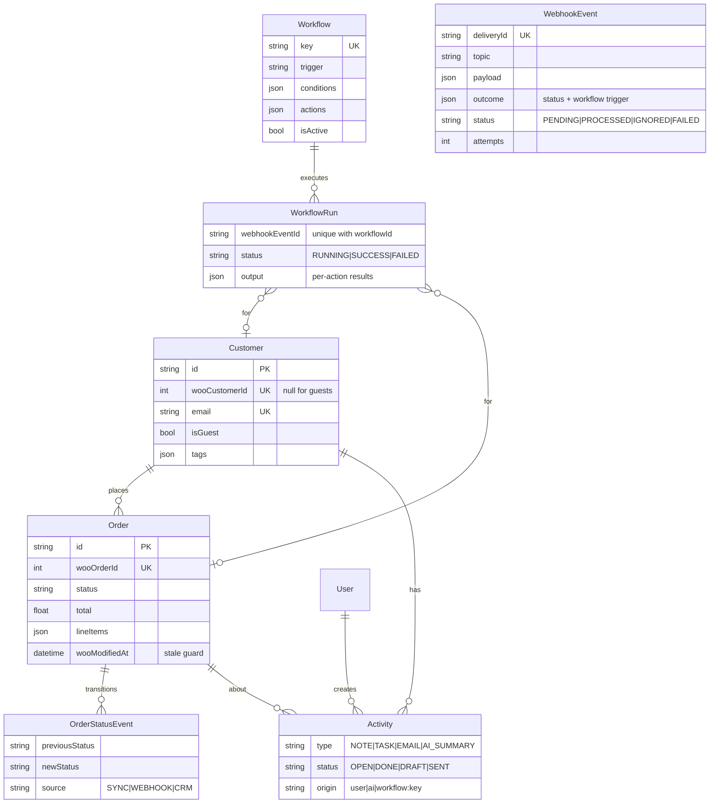

# Architecture

## Processes

| Process | Entry point | Responsibility |
|---|---|---|
| **API** | `server/src/server.ts` → `app.ts` | REST API (JWT + RBAC + Zod), webhook intake, initial/full sync, AI endpoints; serves the built React app in production. Starts the PENDING-event sweeper when Redis is used. |
| **Worker** | `server/src/worker.ts` (`npm run worker`) | Consumes the BullMQ queue: applies webhook events, runs workflows, invalidates the cache. Can also run inside the API process (`RUN_WORKER_IN_API=true`). |
| **Redis** | external (`docker compose up -d redis` or native) | BullMQ queue, shared cache, login rate-limit counters |
| **Frontend** | `client/` | React SPA. Talks only to the API; TanStack Query polls so webhook changes appear without a refresh. |

Without `REDIS_URL`, the API consumes the queue in-process and the cache/rate limiter use memory, so the same code runs with zero infrastructure.

## Components

| Component | Location | Responsibility |
|---|---|---|
| Configuration | `server/src/config/env.ts` | Loads `server/.env` **before** parsing (real environment variables take precedence); Zod-validated settings |
| WooCommerce client | `server/src/integrations/woocommerce/woocommerce.client.ts` | Typed REST v3 calls; pagination via `X-WP-TotalPages`; retry with exponential backoff on 429/5xx; Basic auth over HTTPS, OAuth 1.0a over HTTP |
| OAuth 1.0a signing | `woocommerce.oauth.ts` | One-legged OAuth 1.0a (HMAC-SHA256, nonce, timestamp), mirroring `WC_REST_Authentication::check_oauth_signature`; signs against the store's home URL (`WOO_SIGNATURE_BASE_URL` when it differs from the request URL) |
| Mapper | `woocommerce.mapper.ts` | Woo payload → CRM shape: GMT date parsing, money strings → numbers, guest detection |
| Webhook signature | `woocommerce.signature.ts` | `base64(HMAC-SHA256(rawBody, secret))`, constant-time compare |
| Webhook receiver | `modules/webhooks/webhook.routes.ts` | Raw-body route, creation-ping handshake, signature check, persist + enqueue, `202` |
| Webhook service | `modules/webhooks/webhook.service.ts` | Persists raw events, applies them, saves the outcome (incl. workflow trigger) before running workflows, sanitizes errors, re-queues PENDING/FAILED events |
| Queue | `queues/webhook-queue.ts` | One interface, two drivers: **BullMQ** (Redis; `jobId = eventId`, 3 attempts, exponential backoff, every producer call bounded to 1 s) and **in-process** (`lib/job-queue.ts`) |
| Cache | `lib/cache.ts` | Cache-aside for the dashboard and at-risk scan (30 s TTL), invalidated by the worker through Redis; hit/miss stats; fails open |
| Rate limiter | `lib/rate-limit.ts` | Fixed window via `INCR` + `EXPIRE` in one `MULTI`; used for login lockout; fails open |
| Ingest service | `modules/sync/ingest.service.ts` | Idempotent customer/order upserts, guest → registered merge, stale-event guard, transactional status events |
| Sync service | `modules/sync/sync.service.ts` | Paginated full import (customers, then orders oldest-first); never triggers workflows; single in-flight sync |
| Workflow engine | `modules/workflows/` | Builds a context, evaluates conditions (AND), executes actions. Each workflow isolated; runs claimed (`RUNNING`) and unique per (workflow, webhook event) |
| Risk rules | `modules/risk/risk.rules.ts` | Pure function: order + time-in-status + customer metrics → flags |
| AI service | `modules/ai/` | OpenAI-compatible client (no SDK lock-in), grounded summary/draft prompts, tool-calling agent loop |
| Mock store | `server/src/mock-woo/` | WooCommerce REST v3 subset (Basic + OAuth verification), signed webhook delivery, admin page; deterministic seed data with deliberate risk scenarios |

## Webhook processing sequence

```mermaid
sequenceDiagram
  participant W as WooCommerce
  participant A as API (webhook receiver)
  participant DB as SQLite
  participant R as Redis (BullMQ)
  participant K as Worker
  participant E as Workflow engine

  W->>A: POST /api/webhooks/woocommerce (X-WC-Webhook-Signature, Topic, Delivery-ID)
  alt creation ping (webhook_id=…)
    A-->>W: 200
  else invalid signature
    A-->>W: 401 (nothing stored)
  else duplicate Delivery-ID
    A-->>W: 202 {duplicate: true}
  else valid
    A->>DB: insert WebhookEvent (PENDING, raw payload)
    A->>R: add job {eventId}, jobId = eventId (bounded to 1 s)
    Note over A,R: Redis unreachable → event stays PENDING; sweeper re-queues every 30 s
    A-->>W: 202
    R->>K: deliver job
    K->>DB: resolve customer (woo id → email → create guest)
    alt payload older than stored date_modified
      K->>DB: mark IGNORED
    else
      K->>DB: BEGIN · upsert order · insert OrderStatusEvent if status changed · COMMIT
      K->>DB: save outcome (status + trigger)
      K->>E: ORDER_CREATED / ORDER_STATUS_CHANGED / CUSTOMER_CREATED
      E->>DB: per workflow: skip if a run exists for (workflow, event) → claim RUNNING → actions → SUCCESS / FAILED
      K->>DB: mark PROCESSED
      K->>R: invalidate cached dashboard / at-risk
    end
    Note over R,K: job error → 3 attempts with exponential backoff → FAILED (sanitized reason, retryable from Sync health)
  end
```

### Retry safety
- The outcome of applying an event, including its workflow trigger, is stored on `WebhookEvent.outcome` **before** workflows run. A retry reuses it instead of re-detecting a status change that is already committed.
- `WorkflowRun` is unique per `(workflowId, webhookEventId)` and is claimed before actions execute: **at most once per workflow per event**, so customers never receive duplicate emails.
- An invalid workflow definition or failing action marks only that run `FAILED`; other matching workflows still run.

## Redis usage

| Job | Keys | Behaviour | Failure mode |
|---|---|---|---|
| Message queue (BullMQ) | `bull:woopulse-webhooks:*` | API enqueues, worker consumes (concurrency 1 for ordering); 3 attempts, exponential backoff; dedup by job ID | Producer calls time out after 1 s → event stays `PENDING` in SQLite → sweeper re-queues |
| Cache-aside | `woopulse:cache:dashboard:v1`, `woopulse:cache:at-risk:all:v1`, `woopulse:cache:stats` | 30 s TTL; worker deletes keys after each processed event; sync and activity changes also invalidate | Fails open (value recomputed) |
| Login rate limiting | `woopulse:ratelimit:login:<ip>:<email>` | 5 failures / 15 min → 429 + `Retry-After`; reset on success; correct password doesn't bypass an active lockout | Fails open (no lockout rather than locking everyone out) |

The database remains the source of truth: no event exists only in Redis.

## Data model



## AI agent design

```
User request ─▶ LLM (system prompt + tool schemas)
                 │  tool_calls?
                 ├─ yes ─▶ runTool(name, args)  ── zod-validated ──▶ CRM services ─▶ result JSON
                 │          ◀────────────── appended as `tool` message ◀────────────┘
                 │         (max 6 iterations)
                 └─ no  ─▶ final answer + list of tool calls (shown in the UI as a trace)
```

Tools: `search_customers`, `get_customer_profile`, `get_customer_timeline`, `list_orders`, `get_at_risk_orders`, `create_task`, `draft_email`.

Safety:
- **No send tool.** `draft_email` writes a `DRAFT` activity. Sending goes through `POST /activities/:id/send`, which only a human triggers from the UI.
- Tools that write (`create_task`, `draft_email`) are flagged `mutates` and highlighted in the UI trace.
- Every tool argument is validated with Zod. Invalid calls return an error to the model rather than throwing.
- Summary and draft prompts tell the model to use **only** the supplied JSON and to cite order numbers. Drafts must not promise refunds, discounts or dates that aren't in the data.
- Default model: Groq `openai/gpt-oss-120b` (configurable; any OpenAI-compatible endpoint).

Known gaps (tracked in `CRM_ISSUES.md`): provider-side tool-schema validation errors abort a copilot request (AUD-021), and cited `sources` aren't yet filtered against real records (AUD-019).

## Deployment topology

| Setup | How |
|---|---|
| Local, zero infrastructure | `npm run dev` without `REDIS_URL` (in-process queue, memory cache) |
| Local with Redis | Redis via `docker compose up -d redis` or natively; `REDIS_URL` set; `npm run dev` starts API, worker and UI |
| Containers | `docker-compose.yml`: `redis` (AOF persistence), `api` and `worker` from the same image, SQLite on a shared volume |
| Single hosted service | One container with `RUN_WORKER_IN_API=true` and a hosted Redis |

The Docker paths are written but have not yet been executed (see `CRM_ISSUES.md`, ENV-01).

## Scaling path

| Now | Production |
|---|---|
| SQLite via Prisma (shared by API and worker) | `provider = "postgresql"` plus versioned migrations; the schema uses portable types (string enums, JSON-as-text) |
| BullMQ with one queue, concurrency 1 | Shard queues per store (keeps per-store ordering) and add separate queues for sync and workflow actions |
| Log email transport | SMTP / Resend in `deliver()` |
| Polling UI (3 s) | Server-Sent Events from the worker |
| Single store, credentials in environment variables | `storeId` on every table, with per-store credentials encrypted at rest |
