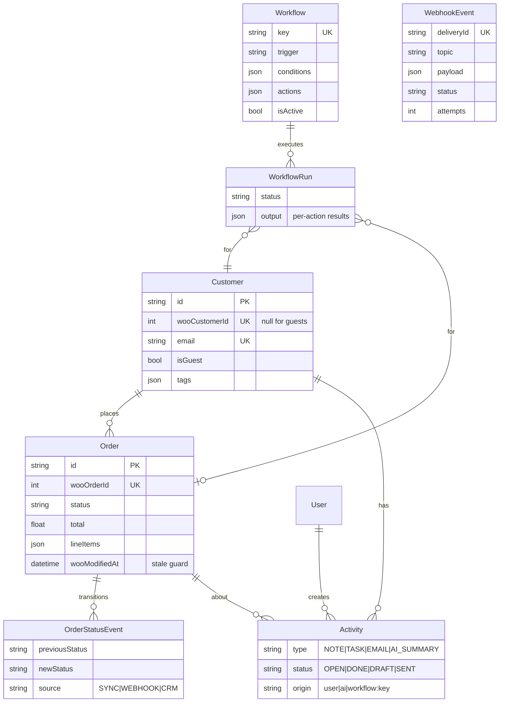

# Architecture

## Components

| Component | Location | Responsibility |
|---|---|---|
| WooCommerce client | `server/src/integrations/woocommerce/woocommerce.client.ts` | Typed REST v3 calls, Basic auth with consumer key/secret, pagination via `X-WP-TotalPages`, retry on 429/5xx |
| Mapper | `woocommerce.mapper.ts` | Woo payload → CRM shape: GMT date parsing, money strings → numbers, guest detection |
| Signature | `woocommerce.signature.ts` | `base64(HMAC-SHA256(rawBody, secret))`, constant-time compare |
| Webhook receiver | `modules/webhooks/webhook.routes.ts` | Raw-body route, creation-ping handshake, signature check, persist + enqueue, `202` |
| Job queue | `lib/job-queue.ts` | FIFO, single consumer (keeps per-store order), retries with exponential backoff, failure callback |
| Ingest service | `modules/sync/ingest.service.ts` | Idempotent customer/order upserts, guest → registered merge, stale-event guard, transactional status events |
| Workflow engine | `modules/workflows/` | Loads active workflows for a trigger, builds a context, evaluates conditions (AND), executes actions, logs `WorkflowRun` |
| Risk rules | `modules/risk/risk.rules.ts` | Pure function: order + time-in-status + customer metrics → flags |
| AI service | `modules/ai/` | OpenAI-compatible client (no SDK lock-in), grounded summary/draft prompts, tool-calling agent loop |
| Mock store | `server/src/mock-woo/` | WooCommerce REST v3 subset + signed webhook delivery + admin panel; deterministic seed data with deliberate risk scenarios |

## Webhook processing sequence

```mermaid
sequenceDiagram
  participant W as WooCommerce
  participant R as Webhook receiver
  participant DB as Database
  participant Q as Job queue
  participant I as Ingest service
  participant E as Workflow engine

  W->>R: POST /api/webhooks/woocommerce (X-WC-Webhook-Signature, Topic, Delivery-ID)
  alt creation ping (webhook_id=…)
    R-->>W: 200
  else invalid signature
    R-->>W: 401
  else duplicate Delivery-ID
    R-->>W: 202 {duplicate: true}
  else valid
    R->>DB: insert WebhookEvent (PENDING, raw payload)
    R->>Q: enqueue(eventId)
    R-->>W: 202
    Q->>I: process event
    I->>DB: resolve customer (woo id → email → create guest)
    alt payload older than stored date_modified
      I->>DB: mark IGNORED
    else
      I->>DB: BEGIN; upsert order; insert OrderStatusEvent if status changed; COMMIT
      I->>E: ORDER_CREATED / ORDER_STATUS_CHANGED / CUSTOMER_CREATED
      E->>DB: evaluate conditions → create tasks / send emails / tag → WorkflowRun
      I->>DB: mark PROCESSED
    end
    Note over Q: on error: retry ×3 with backoff, then FAILED (retryable from UI)
  end
```

## Data model



## AI agent design

```
User request ─▶ LLM (system prompt + tool schemas)
                 │  tool_calls?
                 ├─ yes ─▶ runTool(name, args)  ── zod-validated ──▶ CRM services ─▶ result JSON
                 │          ◀────────────── appended as `tool` message ◀────────────┘
                 │         (max 6 iterations)
                 └─ no  ─▶ final answer + list of tool calls (shown in the UI as a trace)
```

Tools: `search_customers`, `get_customer_profile`, `get_customer_timeline`, `list_orders`, `get_at_risk_orders`, `create_task`, `draft_email`.

Safety:
- **No send tool.** `draft_email` writes a `DRAFT` activity. Sending goes through `POST /activities/:id/send`, which only a human triggers from the UI.
- Tools that write (`create_task`, `draft_email`) are flagged `mutates` and highlighted in the UI trace.
- Every tool argument is validated with Zod. Invalid calls return an error to the model rather than throwing.
- Summary and draft prompts tell the model to use **only** the supplied JSON and to cite order numbers. Drafts must not promise refunds, discounts or dates that aren't in the data.

## Scaling path

| Now (demo) | Production |
|---|---|
| SQLite via Prisma | `provider = "postgresql"`. The schema uses portable types (string enums, JSON-as-text). |
| In-process `JobQueue` with DB-backed durability | BullMQ on Redis. Same `enqueue(eventId)` contract, separate worker process, horizontal scaling. |
| Log email transport | SMTP / Resend in `deliver()` |
| Polling UI (3 s) | Server-Sent Events from the webhook worker |
| Single store | `storeId` on every table, with per-store credentials encrypted at rest |
